<p align="center">
  
</p>

<p align="center">
  <a href="mailto:herbertylive@gmail.com"></a>
  
  
</p>

---

### `> sobre`

Sou **desenvolvedor Full Stack** na **SEADES/AL** (Secretaria de Estado da Assistência e Desenvolvimento Social de Alagoas) e estudante de **Ciência da Computação no IC/UFAL**. Meu trabalho mora no encontro entre **software e política pública**: painéis, relatórios e análises que transformam planilha bagunçada em decisão de gestão — de dados eleitorais por zona e local de votação a indicadores de comunidades quilombolas e do SUAS.

Na faculdade, pesquiso **redes**: meu TCC mede como a **comutação Cut-Through e Store-and-Forward** afetam a qualidade de experiência do **WebRTC** sob estresse, com simulações no **ns-3**. Fora do expediente, estou construindo o **QuemFaz**, um marketplace que conecta quem precisa de um serviço em casa a quem sabe fazer.

```ts
const herberty = {
  agora:       ["Full Stack Jr. @ SEADES/AL", "Ciência da Computação @ UFAL"],
  antes:       ["Gerente de projeto & full stack — Imersão Brisa", "Estágio dev @ SEADES/AL", "Estágio @ SECULT/AL"],
  pesquisa:    "QoE de WebRTC sob estresse de rede (ns-3)",
  construindo: ["QuemFaz", "RiderSync"],
  idiomas:     ["pt-BR", "en", "es"],
  lema:        "resolver com o que já existe antes de adicionar mais uma dependência",
};
```

### `> stack`

<p align="center">
  
  <br/>
  
</p>

<p align="center">
  <sub>também: <b>ns-3</b> · <b>WebSockets</b> · <b>JWT</b> · <b>OpenGL</b> · <b>PlantUML</b> · <b>Render</b> · análise de dados públicos e visualização</sub>
</p>

### `> pesquisa`

<p align="center">
  
</p>

<sub>180 execuções numa matriz de 9 codecs × 4 cargas. Cut-Through segura a latência estável enquanto Store-and-Forward cresce até 30× sob carga; a voz se mantém com MOS alto em todos os cenários, e há um regime de colapso claro a partir de 70 Mbps de tráfego TCP em rajadas. Orientação: Prof. Dr. Almir Pereira Guimarães.</sub>

### `> projetos em destaque`

<table>
  <tr>
    <td width="50%" valign="top">
      <h4>🗳️ <a href="https://github.com/HerbertyFreire/alagoas-2turno">Raio-X eleitoral de Alagoas</a></h4>
      Análise interativa das eleições de 2026 em Alagoas por município, zona, local de votação e faixa etária — apresentada à gestão estadual e publicada na Vercel.
      <br/><br/>
      
      
      
    </td>
    <td width="50%" valign="top">
      <h4>🏠 QuemFaz <sup><code>em construção</code></sup></h4>
      Marketplace de serviços domésticos que conecta clientes a eletricistas, encanadores, diaristas e outros profissionais. <i>“Se você não sabe, chame QuemFaz.”</i>
      <br/><br/>
      
      
    </td>
  </tr>
  <tr>
    <td width="50%" valign="top">
      <h4>📍 <a href="https://github.com/HerbertyFreire/SpotLy">SpotLy</a></h4>
      Back-end em Node.js com autenticação JWT, ORM Prisma, processamento de imagens com Sharp e recuperação de senha por e-mail, em produção no Render.
      <br/><br/>
      
      
      
    </td>
    <td width="50%" valign="top">
      <h4>🎸 RiderSync</h4>
      Plataforma para artistas independentes de Alagoas: gestão de rider técnico/backline entre bandas e casas de show, currículo da banda e monitoramento de editais de fomento cultural.
      <br/><br/>
      
      
    </td>
  </tr>
  <tr>
    <td width="50%" valign="top">
      <h4>🎞️ <a href="https://github.com/HerbertyFreire/Conversor-MPEG-para-MP4">Conversor MPEG → MP4</a></h4>
      Nasceu de um problema real no trabalho: converter vídeos em lote, localmente, sem depender de conversores online cheios de limites.
      <br/><br/>
      
      
    </td>
    <td width="50%" valign="top">
      <h4>📊 Painéis de gestão social <sup><code>SEADES/AL</code></sup></h4>
      Painel interativo de Educação Permanente do SUAS (filtros por ano, município, modalidade e área técnica), relatórios do CEAS/AL com o Censo SUAS e mapas de comunidades quilombolas.
      <br/><br/>
      
      
    </td>
  </tr>
</table>

<details>
<summary><b>Mais coisas por aqui</b></summary>
<br/>

| Projeto | O que é |
|---|---|
| [Chatbot-clinica-Odontologica](https://github.com/HerbertyFreire/Chatbot-clinica-Odontologica) | Chatbot de atendimento para clínica odontológica (JavaScript) |
| [Diagnostico-de-veterinario](https://github.com/HerbertyFreire/Diagnostico-de-veterinario) | Sistema de consulta e diagnóstico veterinário com *frames* — disciplina de IA |
| [GraphAlgorithms-](https://github.com/HerbertyFreire/GraphAlgorithms-) | Algoritmos em grafos em C++ |
| [Planetas-Orbitando-](https://github.com/HerbertyFreire/Planetas-Orbitando-) · [Campo-de-Futebol](https://github.com/HerbertyFreire/Campo-de-Futebol) | Computação gráfica com OpenGL |
| [Centro-Historico](https://github.com/HerbertyFreire/Centro-Historico) | Projeto em Python |
| Chat WebSocket | Servidor de chat com broadcast e sessões (`ws`) — Sistemas Distribuídos |

</details>

### `> números`

<p align="center">
  
</p>
<p align="center">
  
</p>

<p align="center">
  <picture>
    <source media="(prefers-color-scheme: dark)" srcset="https://raw.githubusercontent.com/HerbertyFreire/HerbertyFreire/output/snake-dark.svg"/>
    
  </picture>
</p>

<p align="center">
  
</p>
